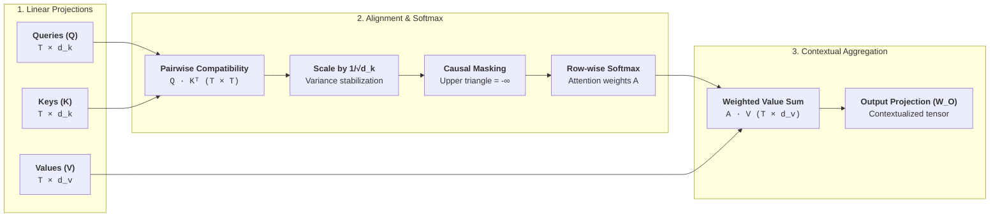

Before the emergence of attention, sequence modeling was dominated by Recurrent Neural Networks (RNNs, LSTMs, and GRUs). In an RNN, computing the hidden state $h_t$ at time step $t$ strictly required the prior state $h_{t-1}$:

$$
h_t = \tanh(W_{hh} h_{t-1} + W_{xh} x_t)
$$

This unbroken recurrence chain created two fundamental engineering roadblocks:

1. **The Parallelization Barrier**: An RNN cannot process token $t+1$ until token $t$ finishes executing. Training could not scale efficiently across distributed GPU clusters along the sequence dimension.
2. **Information Bottlenecks**: Compressing an entire sequence of hundreds or thousands of tokens into a single, fixed-size vector $h_t$ caused early context to be gradually overwritten and forgotten.

**Attention** eliminated sequential recurrence entirely. Instead of passing state through time, attention treats every token in a sequence as an addressable database entry. Contextualization is reframed as a parallelized, content-based associative retrieval:

* **Query ($\mathbf{Q}$)**: *"What information am I searching for?"*
* **Key ($\mathbf{K}$)**: *"What topics and context do I represent?"*
* **Value ($\mathbf{V}$)**: *"What raw content do I provide if selected?"*

By computing compatibility scores between Queries and Keys, each token dynamically routes information from across the entire sequence in a single parallel operation.

---

## The Attention Pipeline: Scaled Dot-Product & Multi-Head Attention

Scaled dot-product attention computes compatibility between queries, keys, and values through the following structured pipeline:



---

## Step-by-Step Forward Pass Walkthrough

To trace the arithmetic mechanics, let us calculate the forward pass for an autoregressive sequence of 3 tokens ($T=3$) with a head dimension of $d_k = 2$:

$$
\text{Tokens: } [t_1: \text{"The"}, \quad t_2: \text{"cat"}, \quad t_3: \text{"sat"}]
$$

### 1. Projecting Inputs to Queries, Keys, and Values
Each token embedding $x_i$ is multiplied by projection matrices $W_Q, W_K, W_V$ to produce explicit coordinate matrices $\mathbf{Q}, \mathbf{K}, \mathbf{V} \in \mathbb{R}^{3 \times 2}$:

$$
\mathbf{Q} = \begin{bmatrix} 1.0 & 0.0 \\ 0.0 & 2.0 \\ 1.0 & 1.0 \end{bmatrix}, \quad
\mathbf{K} = \begin{bmatrix} 1.0 & 1.0 \\ 1.0 & 0.0 \\ 0.0 & 2.0 \end{bmatrix}, \quad
\mathbf{V} = \begin{bmatrix} 2.0 & 0.0 \\ 0.0 & 4.0 \\ 1.0 & 2.0 \end{bmatrix}
$$

### 2. Computing Raw Attention Scores (Q · Kᵀ)
We compute the pairwise dot product between every query and key:

$$
\mathbf{K}^T = \begin{bmatrix} 1.0 & 1.0 & 0.0 \\ 1.0 & 0.0 & 2.0 \end{bmatrix}
$$

$$
\mathbf{S} = \mathbf{Q}\mathbf{K}^T = \begin{bmatrix}
(1)(1) + (0)(1) & (1)(1) + (0)(0) & (1)(0) + (0)(2) \\
(0)(1) + (2)(1) & (0)(1) + (2)(0) & (0)(0) + (2)(2) \\
(1)(1) + (1)(1) & (1)(1) + (1)(0) & (1)(0) + (1)(2)
\end{bmatrix} = \begin{bmatrix}
1.0 & 1.0 & 0.0 \\
2.0 & 0.0 & 4.0 \\
2.0 & 1.0 & 2.0
\end{bmatrix}
$$

Each row $i$ represents how strongly token $i$ attends to tokens $1, 2, 3$.

### 3. Scaling by √d_k to Stabilize Gradients
Because the head dimension is $d_k = 2$, our scaling factor is $\sqrt{d_k} = \sqrt{2} \approx \mathbf{1.414}$.
Dividing each element of $\mathbf{S}$ by $1.414$:

$$
\mathbf{S}_{\text{scaled}} = \frac{\mathbf{S}}{\sqrt{2}} \approx \begin{bmatrix}
0.707 & 0.707 & 0.000 \\
1.414 & 0.000 & 2.828 \\
1.414 & 0.707 & 1.414
\end{bmatrix}
$$

> **The Mathematical Intuition for Scaling**:  
> If the components of $\mathbf{q}$ and $\mathbf{k}$ are independent random variables with zero mean and variance $\sigma^2 = 1$, their dot product $\sum_{i=1}^{d_k} q_i k_i$ has mean $0$ and variance $d_k$.  
> When $d_k$ is large (e.g., $d_k = 128$), dot products grow to large magnitudes ($>15$). When fed into $\text{softmax}$, large inputs push activations into regions where the gradient is essentially zero ($\approx 0$), killing gradient backpropagation. Dividing by $\sqrt{d_k}$ normalizes the variance back to $1.0$.

### 4. Autoregressive Causal Masking
In an autoregressive language model, token $t$ is strictly forbidden from looking into future tokens ($t' > t$). We enforce this by setting the upper triangle of the score matrix to $-\infty$:

$$
\mathbf{S}_{\text{masked}} = \begin{bmatrix}
0.707 & -\infty & -\infty \\
1.414 & 0.000 & -\infty \\
1.414 & 0.707 & 1.414
\end{bmatrix}
$$

Because $e^{-\infty} = 0$, masked positions receive zero attention weight after softmax.

### 5. Probability Normalization via Softmax
Softmax is applied independently across each row to normalize scores into a valid probability distribution ($\sum_j A_{ij} = 1$):

* **Row 1** (`"The"`):
  $e^{0.707} \approx 2.028$. Since future positions are $-\infty$, they contribute $0$:
  $$\mathbf{A}[1, :] = [1.0, \quad 0.0, \quad 0.0]$$
* **Row 2** (`"cat"`):
  $e^{1.414} \approx 4.112, \quad e^0 = 1.0$. Sum $= 5.112$.
  $$\mathbf{A}[2, :] = [4.112/5.112, \quad 1.0/5.112, \quad 0.0] = [\mathbf{0.804}, \quad \mathbf{0.196}, \quad \mathbf{0.0}]$$
* **Row 3** (`"sat"`):
  $e^{1.414} \approx 4.112, \quad e^{0.707} \approx 2.028, \quad e^{1.414} \approx 4.112$. Sum $= 10.252$.
  $$\mathbf{A}[3, :] = [4.112/10.252, \quad 2.028/10.252, \quad 4.112/10.252] = [\mathbf{0.401}, \quad \mathbf{0.198}, \quad \mathbf{0.401}]$$

$$
\mathbf{A} = \begin{bmatrix}
1.000 & 0.000 & 0.000 \\
0.804 & 0.196 & 0.000 \\
0.401 & 0.198 & 0.401
\end{bmatrix}
$$

### 6. Value Aggregation to Form Contextual Outputs
Finally, we compute the output by multiplying the attention probabilities $\mathbf{A}$ by the Value matrix $\mathbf{V}$:

$$
\mathbf{O} = \mathbf{A}\mathbf{V} = \begin{bmatrix}
1.000 & 0.000 & 0.000 \\
0.804 & 0.196 & 0.000 \\
0.401 & 0.198 & 0.401
\end{bmatrix}
\begin{bmatrix}
2.0 & 0.0 \\
0.0 & 4.0 \\
1.0 & 2.0
\end{bmatrix}
$$

* **Token 1 Output (`"The"`)**: $1.0 \times [2.0, 0.0] = \mathbf{[2.000, 0.000]}$
* **Token 2 Output (`"cat"`)**: $0.804 \times [2.0, 0.0] + 0.196 \times [0.0, 4.0] = \mathbf{[1.608, 0.784]}$
* **Token 3 Output (`"sat"`)**: $0.401 \times [2.0, 0.0] + 0.198 \times [0.0, 4.0] + 0.401 \times [1.0, 2.0] = \mathbf{[1.203, 1.594]}$

$$
\mathbf{O} = \begin{bmatrix}
2.000 & 0.000 \\
1.608 & 0.784 \\
1.203 & 1.594
\end{bmatrix}
$$

Token 3 (`"sat"`) has synthesized information from `"The"` (40.1%), `"cat"` (19.8%), and itself (40.1%), producing a rich, contextual vector representation.

---

## Interactive Attention Simulator

Test the mechanics interactively below. Drag the temperature slider to see how variance scaling influences the sharpness of the probability distribution, or toggle causal masking to compare decoder vs. encoder attention:



---

## PyTorch Reference Implementation

Here is how scaled dot-product attention translates into clean, idiomatic PyTorch:

```python
import torch
import torch.nn.functional as F
import math

def scaled_dot_product_attention(
    q: torch.Tensor, 
    k: torch.Tensor, 
    v: torch.Tensor, 
    mask: torch.Tensor = None
) -> tuple[torch.Tensor, torch.Tensor]:
    """
    Args:
        q: Query tensor of shape [batch_size, num_heads, seq_len_q, head_dim]
        k: Key tensor of shape   [batch_size, num_heads, seq_len_k, head_dim]
        v: Value tensor of shape [batch_size, num_heads, seq_len_v, head_dim]
        mask: Optional boolean or additive mask tensor
    Returns:
        output: Contextualized output tensor [batch_size, num_heads, seq_len_q, head_dim]
        attn_weights: Softmax attention map  [batch_size, num_heads, seq_len_q, seq_len_k]
    """
    d_k = q.size(-1)
    
    # 1. Pairwise compatibility scoring (B, H, T_q, T_k)
    scores = torch.matmul(q, k.transpose(-2, -1)) / math.sqrt(d_k)
    
    # 2. Apply causal mask if provided
    if mask is not None:
        scores = scores.masked_fill(mask == 0, float("-inf"))
        
    # 3. Probability normalization
    attn_weights = F.softmax(scores, dim=-1)
    
    # 4. Contextual Value aggregation
    output = torch.matmul(attn_weights, v)
    return output, attn_weights
```

---

## Systems & Hardware Optimization: GPU Memory Hierarchy

### The Memory Bandwidth Wall & KV-Cache Scaling

During prefill (processing the initial prompt), tokens are known upfront and can be processed in parallel, saturating the GPU's tensor computing cores.

However, during **autoregressive token generation**, the model produces one token at a time. Recomputing past token keys and values from scratch on every step would scale compute quadratically ($\mathcal{O}(T^2)$). Instead, modern LLMs maintain a **KV-Cache** in GPU High-Bandwidth Memory (HBM):

$$
\text{KV-Cache Footprint} = 2 \times n_{\text{layers}} \times n_{\text{heads}} \times d_{\text{head}} \times L_{\text{seq}} \times \text{bytes per param}
$$

For a 70B parameter model (80 layers, 64 heads, $d_{\text{head}} = 128$) running at FP16 precision:
* At context length $L = 4{,}096$: $\approx 5.2\text{ GB}$ per user.
* At context length $L = 128{,}000$: **$\approx 163\text{ GB}$ per user**.

When generating each new token, the GPU must stream this entire $163\text{ GB}$ cache from off-chip HBM into on-chip SRAM just to compute dot products against a single new Query vector. The model is not limited by compute (TFLOPs), but by **memory bandwidth (TB/s)**.

### Architectural Solutions: MHA vs. MQA vs. GQA

To break the memory bandwidth bottleneck, modern LLMs use grouped Key-Value sharing architectures:

```
Multi-Head Attention (MHA - Vaswani et al. 2017):
  Queries:  [Q₁] [Q₂] [Q₃] [Q₄] [Q₅] [Q₆] [Q₇] [Q₈]
  Keys:     [K₁] [K₂] [K₃] [K₄] [K₅] [K₆] [K₇] [K₈]  (100% KV Cache)
  Values:   [V₁] [V₂] [V₃] [V₄] [V₅] [V₆] [V₇] [V₈]

Multi-Query Attention (MQA - Shazeer 2019):
  Queries:  [Q₁] [Q₂] [Q₃] [Q₄] [Q₅] [Q₆] [Q₇] [Q₈]
  Keys:     [               K₁               ]  (12.5% KV Cache;
  Values:   [               V₁               ]   slight quality loss)

Grouped-Query Attention (GQA - Ainslie et al. 2023; Llama 3, Mistral):
  Queries:  [Q₁  Q₂]  [Q₃  Q₄]  [Q₅  Q₆]  [Q₇  Q₈]
  Keys:     [  K₁  ]  [  K₂  ]  [  K₃  ]  [  K₄  ]  (25-50% KV Cache;
  Values:   [  V₁  ]  [  V₂  ]  [  V₃  ]  [  V₄  ]   zero quality degradation)
```

By grouping Query heads over shared Key-Value heads, **Grouped-Query Attention (GQA)** cuts memory bandwidth consumption by $4\times$ to $8\times$, drastically accelerating inference throughput.

### SRAM Tiling: FlashAttention (Dao et al.)

Standard naive attention implementations materialize the intermediate $T \times T$ attention matrix in GPU global memory (HBM). For long sequences ($T = 64\text{k}$), reading and writing this quadratic matrix to HBM introduces severe I/O latency.

**FlashAttention** avoids materializing the full $T \times T$ matrix entirely:
1. **Tiling**: Loads small blocks of $Q, K, V$ into high-speed on-chip SRAM ($192\text{ KB}$ per streaming multiprocessor).
2. **Online Softmax**: Computes softmax normalizers incrementally across tiles using running maximums and sums.
3. **IO-Awareness**: Eliminates quadratic HBM roundtrips, reducing memory operations from $\mathcal{O}(T^2)$ to $\mathcal{O}(T)$ and accelerating attention by $2\times$ to $4\times$.

---

## Seminal Papers & References


  
  
  
  

