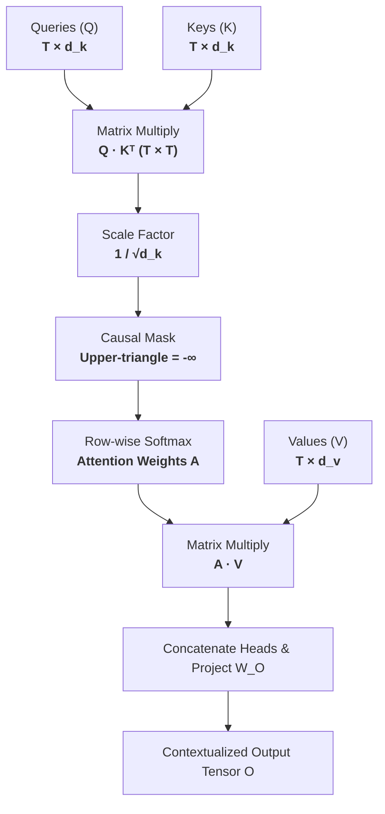

Before the emergence of attention, deep sequence modeling was constrained by the sequential processing paradigm of Recurrent Neural Networks (RNNs, LSTMs, and GRUs). In an RNN, computing the hidden state $h_t$ at time step $t$ strictly required the prior state $h_{t-1}$:

$$
h_t = \tanh(W_{hh} h_{t-1} + W_{xh} x_t)
$$

This unbroken recurrence chain created an architectural impasse on modern computing hardware:

1. **The Parallelization Barrier**: Regardless of whether a cluster possessed eight or eight thousand GPU cores, an RNN could not process token $t+1$ until token $t$ had finished executing. Training could not be parallelized along the sequence dimension.
2. **Information Bottlenecks and Vanishing Gradients**: Compressing a document of hundreds or thousands of tokens into a single, fixed-size vector $h_t$ forced earlier context to be gradually overwritten and forgotten.

**Attention** bypassed sequential recurrence entirely. Instead of passing a state through time, attention treats every token in a sequence as an addressable database entry. Contextualization is reframed as a parallelized, content-based associative retrieval: every token emits a **Query** ($Q$), scans the **Keys** ($K$) of all available tokens, computes alignment scores via dot products, and computes a weighted average over their **Values** ($V$).

---

## Scaled Dot-Product & Multi-Head Pipeline

Scaled dot-product attention processes queries, keys, and values through the following tensor pipeline:



---

## Step-by-Step Toy Walkthrough: Attention Arithmetic

To trace the arithmetic mechanics, let us calculate the forward pass for an autoregressive sequence of 3 tokens ($T=3$) with a head dimension of $d_k = 2$:

$$
\text{Tokens: } [t_1: \text{"The"}, \quad t_2: \text{"cat"}, \quad t_3: \text{"sat"}]
$$

### Step 1: Input Projections ($\mathbf{Q}, \mathbf{K}, \mathbf{V}$)
Assume the linear projection layers produce the following explicit matrices $\mathbf{Q}, \mathbf{K}, \mathbf{V} \in \mathbb{R}^{3 \times 2}$:

$$
\mathbf{Q} = \begin{bmatrix} 1.0 & 0.0 \\ 0.0 & 2.0 \\ 1.0 & 1.0 \end{bmatrix}, \quad
\mathbf{K} = \begin{bmatrix} 1.0 & 1.0 \\ 1.0 & 0.0 \\ 0.0 & 2.0 \end{bmatrix}, \quad
\mathbf{V} = \begin{bmatrix} 2.0 & 0.0 \\ 0.0 & 4.0 \\ 1.0 & 2.0 \end{bmatrix}
$$

### Step 2: Unscaled Score Matrix ($\mathbf{S} = \mathbf{Q}\mathbf{K}^T$)
We compute the pairwise dot product between every query and key:

$$
\mathbf{K}^T = \begin{bmatrix} 1.0 & 1.0 & 0.0 \\ 1.0 & 0.0 & 2.0 \end{bmatrix}
$$

$$
\mathbf{S} = \mathbf{Q}\mathbf{K}^T = \begin{bmatrix}
(1)(1) + (0)(1) & (1)(1) + (0)(0) & (1)(0) + (0)(2) \\
(0)(1) + (2)(1) & (0)(1) + (2)(0) & (0)(0) + (2)(2) \\
(1)(1) + (1)(1) & (1)(1) + (1)(0) & (1)(0) + (1)(2)
\end{bmatrix} = \begin{bmatrix}
1.0 & 1.0 & 0.0 \\
2.0 & 0.0 & 4.0 \\
2.0 & 1.0 & 2.0
\end{bmatrix}
$$

### Step 3: Scaling by $\sqrt{d_k}$
The head dimension is $d_k = 2$, so $\sqrt{d_k} = \sqrt{2} \approx \mathbf{1.414}$.
Dividing each element of $\mathbf{S}$ by $1.414$:

$$
\mathbf{S}_{\text{scaled}} = \frac{\mathbf{S}}{\sqrt{2}} \approx \begin{bmatrix}
0.707 & 0.707 & 0.000 \\
1.414 & 0.000 & 2.828 \\
1.414 & 0.707 & 1.414
\end{bmatrix}
$$

> **Why divide by $\sqrt{d_k}$?**  
> If components of $\mathbf{q}$ and $\mathbf{k}$ are independent random variables with zero mean and unit variance, their dot product has a mean of 0 and a variance of $d_k$. As $d_k$ grows large (e.g., $d_k = 128$), the dot products grow proportionally in magnitude, pushing the subsequent softmax into saturated regions with vanishing gradients. Dividing by $\sqrt{d_k}$ resets the variance back to 1.0.

### Step 4: Causal Triangular Masking
In an autoregressive decoder, token $t$ is forbidden from attending to future tokens $t' > t$. We set the upper triangle (where column index $>$ row index) to $-\infty$:

$$
\mathbf{S}_{\text{masked}} = \begin{bmatrix}
0.707 & -\infty & -\infty \\
1.414 & 0.000 & -\infty \\
1.414 & 0.707 & 1.414
\end{bmatrix}
$$

### Step 5: Row-Wise Softmax ($\mathbf{A} = \text{softmax}(\mathbf{S}_{\text{masked}})$)
Softmax is applied independently across each row. Recall that $e^{-\infty} = 0$:

* **Row 1** (`"The"`):
  $e^{0.707} \approx 2.028$. Since other positions are 0:
  $\mathbf{A}[1, :] = [1.0, \quad 0.0, \quad 0.0]$
* **Row 2** (`"cat"`):
  $e^{1.414} \approx 4.112, \quad e^0 = 1.0$. Sum $= 5.112$.
  $\mathbf{A}[2, :] = [4.112/5.112, \quad 1.0/5.112, \quad 0.0] = [\mathbf{0.804}, \quad \mathbf{0.196}, \quad \mathbf{0.0}]$
* **Row 3** (`"sat"`):
  $e^{1.414} \approx 4.112, \quad e^{0.707} \approx 2.028, \quad e^{1.414} \approx 4.112$. Sum $= 10.252$.
  $\mathbf{A}[3, :] = [4.112/10.252, \quad 2.028/10.252, \quad 4.112/10.252] = [\mathbf{0.401}, \quad \mathbf{0.198}, \quad \mathbf{0.401}]$

$$
\mathbf{A} = \begin{bmatrix}
1.000 & 0.000 & 0.000 \\
0.804 & 0.196 & 0.000 \\
0.401 & 0.198 & 0.401
\end{bmatrix}
$$

### Step 6: Output Computation ($\mathbf{O} = \mathbf{A} \mathbf{V}$)
We multiply the attention probabilities by the Value matrix $\mathbf{V}$:

$$
\mathbf{O} = \begin{bmatrix}
1.000 & 0.000 & 0.000 \\
0.804 & 0.196 & 0.000 \\
0.401 & 0.198 & 0.401
\end{bmatrix}
\begin{bmatrix}
2.0 & 0.0 \\
0.0 & 4.0 \\
1.0 & 2.0
\end{bmatrix}
$$

* **Token 1 Output**: $1.0 \times [2.0, 0.0] = \mathbf{[2.000, 0.000]}$
* **Token 2 Output**: $0.804 \times [2.0, 0.0] + 0.196 \times [0.0, 4.0] = \mathbf{[1.608, 0.784]}$
* **Token 3 Output**: $0.401 \times [2.0, 0.0] + 0.198 \times [0.0, 4.0] + 0.401 \times [1.0, 2.0] = \mathbf{[1.203, 1.594]}$

$$
\mathbf{O} = \begin{bmatrix}
2.000 & 0.000 \\
1.608 & 0.784 \\
1.203 & 1.594
\end{bmatrix}
$$

Token 3 (`"sat"`) has now integrated information from both `"The"` (40.1%), `"cat"` (19.8%), and itself (40.1%), creating a contextualized representation ready for subsequent feed-forward layers.

---

## A Bit Deeper: Systems & Mechanics

### The Memory-Bandwidth Wall & KV-Caching
During training, all tokens are known simultaneously, allowing parallel matrix multiplications. But during **autoregressive inference**, tokens are generated one by one.

To generate token $t+1$, the model does not recompute attention for past tokens from scratch. It maintains a **KV-Cache** storing the Key and Value vectors of all previous tokens:

$$
\text{KV-Cache Size} = 2 \times n_{\text{layers}} \times n_{\text{heads}} \times d_{\text{head}} \times L_{\text{seq}} \times \text{precision (bytes)}
$$

For a 70B model with 80 layers and 64 heads ($d=128$) at a 128k context length, the KV-cache for a single user exceeds **80 GB of VRAM**. Generating each token requires streaming this entire 80 GB from high-bandwidth GPU memory (HBM) into on-chip cache (SRAM) just to multiply by a single Query vector. Generation becomes entirely **memory-bandwidth bound**.

### Attention Architectures: MHA vs. MQA vs. GQA

```
Multi-Head Attention (MHA):
  Queries:  [Q₁] [Q₂] [Q₃] [Q₄] [Q₅] [Q₆] [Q₇] [Q₈]
  Keys:     [K₁] [K₂] [K₃] [K₄] [K₅] [K₆] [K₇] [K₈]  (100% KV cache size)
  Values:   [V₁] [V₂] [V₃] [V₄] [V₅] [V₆] [V₇] [V₈]

Multi-Query Attention (MQA - Shazeer 2019):
  Queries:  [Q₁] [Q₂] [Q₃] [Q₄] [Q₅] [Q₆] [Q₇] [Q₈]
  Keys:     [               K₁               ]  (12.5% KV cache size;
  Values:   [               V₁               ]   minor accuracy loss)

Grouped-Query Attention (GQA - Ainslie et al. 2023; Llama 2/3, Mistral):
  Queries:  [Q₁  Q₂]  [Q₃  Q₄]  [Q₅  Q₆]  [Q₇  Q₈]
  Keys:     [  K₁  ]  [  K₂  ]  [  K₃  ]  [  K₄  ]  (25-50% KV cache size;
  Values:   [  V₁  ]  [  V₂  ]  [  V₃  ]  [  V₄  ]   zero accuracy degradation)
```

By assigning groups of Query heads to share a single Key-Value head, **Grouped-Query Attention (GQA)** delivers up to an $8\times$ reduction in memory bandwidth and KV-cache footprints during generation with virtually zero loss in model capability.

### Hardware-Aware FlashAttention (Dao et al. 2022)
Standard PyTorch implementations compute attention in sequential stages:
1. Load $Q, K$ from slow GPU High Bandwidth Memory (HBM) to on-chip SRAM.
2. Compute $S = QK^T$ and write $S \in \mathbb{R}^{N \times N}$ back to HBM.
3. Load $S$ from HBM, compute softmax $A = \text{softmax}(S)$, write $A \in \mathbb{R}^{N \times N}$ back to HBM.
4. Load $A$ and $V$ from HBM, compute $O = AV$, write $O$ back to HBM.

For a context of $N=64{,}000$, materializing the $N \times N$ matrix requires reading and writing billions of floats to memory, causing extreme IO bottlenecks.

**FlashAttention** solves this using **kernel fusion and tiling**:
* It partitions $Q, K, V$ into small blocks that fit entirely within high-speed SRAM (100–250 KB per streaming multiprocessor).
* It computes the softmax scaling factors incrementally using the online softmax trick without ever materializing the quadratic $N \times N$ attention matrix in HBM.
* Memory access is reduced from $\mathcal{O}(N^2)$ to $\mathcal{O}(N)$, speeding up attention computation by $2\times$ to $4\times$ and cutting peak memory consumption by an order of magnitude.

---

## Seminal Papers & References


  
  
  
  

