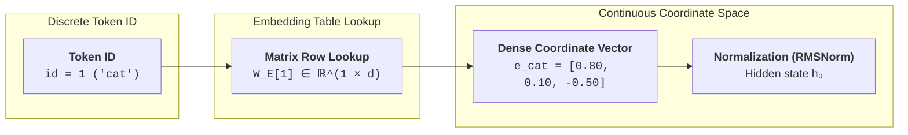

Once tokenization converts raw text strings into discrete integer token IDs, neural networks face a fundamental geometric question: how can arbitrary discrete numbers like `1923` and `4812` be represented in a space where mathematical operations like vector addition, dot products, and gradient updates carry semantic meaning?

The most basic representation is a **one-hot vector** $e_i \in \{0, 1\}^V$, where an index is represented by an array of zeros with a single $1$ at position $i$. While straightforward, one-hot encodings suffer from two critical flaws:

1. **Orthogonality and Semantic Blindness**: The dot product between any two distinct one-hot vectors is identically zero:
   $$
   e_i \cdot e_j = 0 \quad (\forall i \neq j)
   $$
   In one-hot space, `cat` is just as distant from `kitten` as it is from `refrigerator`. The model cannot share statistical learning across semantically related words.
2. **The Curse of Dimensionality**: In modern LLMs with vocabulary size $V = 128{,}000$ (e.g. LLaMA 3), a single one-hot vector requires 128,000 sparse dimensions per token, wasting memory and computation.

**Dense embeddings** resolve this by projecting discrete tokens into a continuous coordinate space $\mathbb{R}^d$ (typically $d \in [2048, 8192]$). In this continuous space, tokens become dense vectors whose geometric distances (Euclidean norm) and angular orientations (cosine similarity) reflect linguistic meaning and functional relationships.

---

## From Discrete Tokens to Continuous Vectors

The embedding layer operates as an efficient table lookup into a learned parameter matrix $\mathbf{W}_E \in \mathbb{R}^{V \times d}$:

---

## Vector Geometry & Memory Layout

To see how embedding matrices are indexed and how semantic similarity is quantified geometrically, consider a toy embedding space with vocabulary size $V=5$ and hidden dimension $d=3$.

### 1. Embedding Matrix Structure
Let our miniature vocabulary be:
$$
\mathcal{V} = \{ 0: \text{the}, \quad 1: \text{cat}, \quad 2: \text{sat}, \quad 3: \text{dog}, \quad 4: \text{mat} \}
$$

The model maintains a learned weight matrix $\mathbf{W}_E \in \mathbb{R}^{5 \times 3}$:

$$
\mathbf{W}_E = \begin{bmatrix}
0.05 & -0.12 & 0.08 \\
0.80 &  0.10 & -0.50 \\
0.15 &  0.90 &  0.20 \\
0.78 &  0.12 & -0.48 \\
0.10 & -0.05 &  0.85
\end{bmatrix}
\begin{matrix}
\leftarrow \text{row 0 (the)} \\
\leftarrow \text{row 1 (cat)} \\
\leftarrow \text{row 2 (sat)} \\
\leftarrow \text{row 3 (dog)} \\
\leftarrow \text{row 4 (mat)}
\end{matrix}
$$

### 2. Memory Lookup & Gather
When the sequence `[cat, dog]` (token IDs `[1, 3]`) enters the model, the embedding layer retrieves rows 1 and 3:

$$
\mathbf{e}_{\text{cat}} = \mathbf{W}_E[1] = \begin{bmatrix} 0.80, & 0.10, & -0.50 \end{bmatrix}
$$
$$
\mathbf{e}_{\text{dog}} = \mathbf{W}_E[3] = \begin{bmatrix} 0.78, & 0.12, & -0.48 \end{bmatrix}
$$

Mathematically, this lookup is equivalent to multiplying a one-hot row vector $e_1^T \in \mathbb{R}^{1 \times V}$ by the weight matrix $\mathbf{W}_E \in \mathbb{R}^{V \times d}$:
$$
e_1^T \mathbf{W}_E = \mathbf{e}_{\text{cat}}
$$
In GPU kernels, this is implemented as an $\mathcal{O}(1)$ direct memory index lookup, bypassing full matrix multiplication.

### 3. Measuring Semantic Similarity
How close are `cat` and `dog` in this continuous coordinate space?

1. **Dot Product (Projection Alignment)**:
   $$
   \mathbf{e}_{\text{cat}} \cdot \mathbf{e}_{\text{dog}} = (0.80)(0.78) + (0.10)(0.12) + (-0.50)(-0.48) = \mathbf{0.876}
   $$

2. **Vector Magnitudes (Euclidean Norms)**:
   $$
   \|\mathbf{e}_{\text{cat}}\| = \sqrt{0.80^2 + 0.10^2 + (-0.50)^2} = \sqrt{0.64 + 0.01 + 0.25} = \sqrt{0.90} \approx 0.9487
   $$
   $$
   \|\mathbf{e}_{\text{dog}}\| = \sqrt{0.78^2 + 0.12^2 + (-0.48)^2} = \sqrt{0.6084 + 0.0144 + 0.2304} = \sqrt{0.8532} \approx 0.9237
   $$

3. **Cosine Similarity (Angular Affinity)**:
   $$
   \cos(\theta) = \frac{\mathbf{e}_{\text{cat}} \cdot \mathbf{e}_{\text{dog}}}{\|\mathbf{e}_{\text{cat}}\| \|\mathbf{e}_{\text{dog}}\|} = \frac{0.876}{0.9487 \times 0.9237} = \frac{0.876}{0.8763} \approx \mathbf{0.9996}
   $$

A cosine similarity of $\approx 0.9996$ indicates that both coordinate vectors point in nearly identical directions, reflecting their shared linguistic status as animals. In contrast, comparing `cat` against the grammatical function word `the` yields $\cos(\theta) \approx -0.11$, demonstrating functional orthogonality.

---

## Interactive Embedding Space Simulator



---

## Memory Optimization & Normalization

### Weight Tying

In an autoregressive language model, an embedding lookup occurs at the very start (converting token IDs to hidden states), and an inverse projection occurs at the very end: the final hidden state $h_L \in \mathbb{R}^d$ is multiplied by an output projection matrix $\mathbf{W}_{\text{head}} \in \mathbb{R}^{d \times V}$ to produce logits over the entire vocabulary:

$$
\text{logits} = h_L \mathbf{W}_{\text{head}}
$$

**Weight Tying** (Press & Wolf 2016) sets the output projection weights to be the exact transpose of the input embedding weights:
$$
\mathbf{W}_{\text{head}} = \mathbf{W}_E^T
$$

**Key Benefits for LLMs**:
1. **Parameter Savings**: In a model with hidden size $d=4096$ and vocabulary $V=128{,}000$, a single embedding matrix occupies $4096 \times 128{,}000 \approx \mathbf{524\text{ million}}$ parameters ($1.05\text{ GB}$ of VRAM in FP16). Tying weights eliminates an entire 524M-parameter matrix.
2. **Regularization & Geometry**: It forces the continuous space where tokens enter the model to be geometrically identical to the space where tokens are predicted, preventing representation collapse on rare tokens.

### Embedding Scale Factor

In the original Transformer (Vaswani et al. 2017), lookup vectors were multiplied by $\sqrt{d_{\text{model}}}$ before adding positional encodings:

$$
\mathbf{x}_i = \sqrt{d_{\text{model}}} \cdot \mathbf{W}_E[t_i] + \mathbf{PE}_i
$$

Under standard Gaussian weight initialization (mean 0, variance $1/d_{\text{model}}$), the expected norm of an embedding vector is $\mathcal{O}(1)$. Because sinusoidal positional values also have magnitudes of $\mathcal{O}(1)$, adding them directly would cause the position signal to overpower the semantic signal. Scaling by $\sqrt{d_{\text{model}}}$ ensures semantic representations remain dominant.

### LayerNorm vs. RMSNorm

Embeddings passing through dozens of transformer layers require normalization to stabilize gradient propagation. Modern models have largely migrated from standard LayerNorm to **Root Mean Square Normalization (RMSNorm)**:

* **Standard LayerNorm** (Vaswani et al. 2017) requires two reduction passes (mean $\mu$ and variance $\sigma^2$):
  $$
  \text{LayerNorm}(\mathbf{x}) = \frac{\mathbf{x} - \mu}{\sqrt{\sigma^2 + \epsilon}} \odot \boldsymbol{\gamma} + \boldsymbol{\beta}
  $$
* **RMSNorm** (Zhang & Sennrich 2019; LLaMA 3, Mistral) strips mean-centering, reducing GPU memory bandwidth overhead by $15\text{--}40\%$:
  $$
  \text{RMSNorm}(\mathbf{x}) = \frac{\mathbf{x}}{\sqrt{\frac{1}{d}\sum_{i=1}^d x_i^2 + \epsilon}} \odot \boldsymbol{\gamma}
  $$

By removing the need to compute the mean $\mu$, RMSNorm reduces GPU memory read/write passes (SRAM-to-HBM bandwidth) while delivering identical convergence stability.

---

## Key Papers & References


  
  
  

