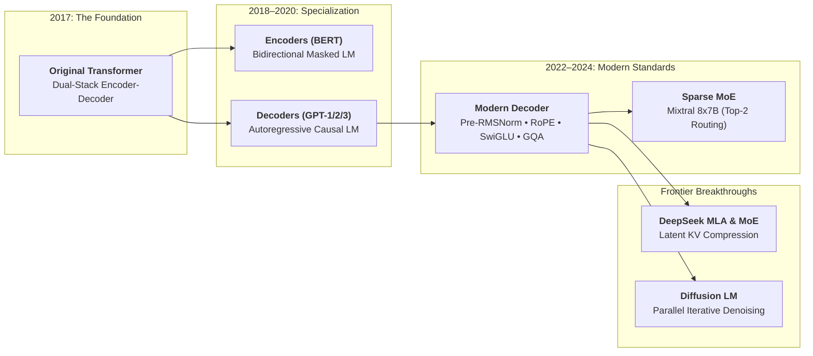
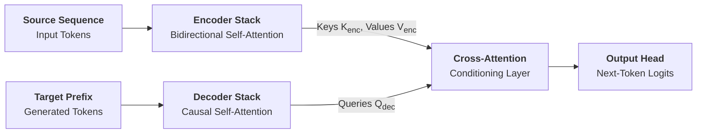
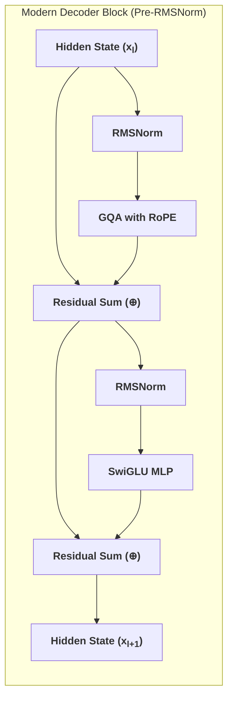
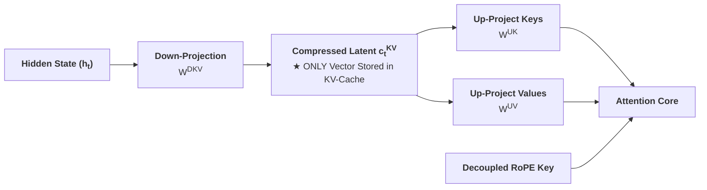

The architectural evolution of large language models is the story of an empirical search across three engineering tensions: **representational capacity**, **parallel training throughput**, and **inference generation latency**.

Rather than remaining a static blueprint, the Transformer evolved through distinct developmental epochs. Each major architectural transition was triggered by a specific hardware bottleneck, memory wall, or scaling law discovery—culminating in modern frontier models that synthesize pre-normalized residual streams, gated activations, sparse expert routing, and low-rank latent attention.

---

## Evolution of Transformer Architectures

How the fundamental Transformer evolved from a translation dual-stack into modern frontier decoders:

---

## 1. Original Encoder-Decoder

Prior to 2017, sequence-to-sequence translation relied on recurrent networks (LSTMs, GRUs) that processed tokens step-by-step. The original Transformer broke this bottleneck by introducing a dual-stack **Encoder-Decoder** architecture built purely on self-attention and cross-attention:

### Cross-Attention Conditioning
* **The Encoder**: Consumes the full source sentence using unmasked bidirectional attention, computing contextual representations $H_{\text{enc}} \in \mathbb{R}^{S \times d}$.
* **The Decoder**: Generates the target sentence autoregressively. Each decoder layer performs two distinct attention passes:
  1. **Causal Self-Attention**: Allows target tokens to attend only to earlier generated tokens ($t' \le t$).
  2. **Cross-Attention**: Target tokens emit **Queries** ($Q_{\text{dec}}$), but retrieve **Keys** ($K_{\text{enc}}$) and **Values** ($V_{\text{enc}}$) directly from the encoder representations:
     $$
     \text{CrossAttention}(Q_{\text{dec}}, K_{\text{enc}}, V_{\text{enc}}) = \text{softmax}\left(\frac{Q_{\text{dec}} K_{\text{enc}}^T}{\sqrt{d_k}}\right) V_{\text{enc}}
     $$

---

## 2. Encoders vs. Decoders

Between 2018 and 2020, researchers discovered that the two halves of the Transformer could be decoupled for fundamentally different tasks:

### Bidirectional Encoders (BERT)
By discarding the decoder and training solely on **Masked Language Modeling (MLM)** (randomly masking 15% of tokens and training the model to predict them from surrounding bidirectional context), BERT achieved breakthroughs in text classification, semantic search, and passage ranking.
* **The Generation Limit**: Because attention is fully bidirectional, an encoder cannot generate open-ended text efficiently. Predicting a 100-token paragraph would require 100 separate, full forward passes from scratch.

### Autoregressive Decoders (GPT)
By discarding the encoder and training purely on **causal next-token prediction** ($p(x_t \mid x_{<t})$), the GPT series demonstrated that next-token prediction at massive scale absorbs world knowledge, logical reasoning, and zero-shot task execution without task-specific fine-tuning. Empirical scaling laws established causal decoders as the most compute-efficient architecture for pre-training.

---

## 3. The Modern Decoder Block

Modern frontier foundation models (LLaMA 3, Mistral, Gemma, Qwen) have converged on a standardized autoregressive block engineered for training stability at depth and inference efficiency:

### Pre-LN & Residual Connections
Think of a deep Transformer not as a rigid stack of layers, but as a high-speed **information highway** (the residual stream).
* Each attention layer and MLP block simply reads from the highway, computes an additive refinement, and deposits it back onto the highway:
  $$
  x_{l+1} = x_l + f(x_l)
  $$
* Under **Pre-RMSNorm**, activations are normalized *before* entering the sublayer, preserving an unobstructed identity path where gradients backpropagate unimpeded from layer $L$ to layer $1$. This allows 100+ layer networks to train stably without exploding or vanishing gradients.

### SwiGLU Feed-Forward Networks
Traditional transformers used standard MLPs with ReLU or GELU activations. Modern models replace this with **SwiGLU** (Shazeer 2020), a Gated Linear Unit with Swish activation ($\text{Swish}(x) = x \cdot \sigma(x)$):

$$
\text{SwiGLU}(x) = \left( \text{Swish}(x W_{\text{gate}}) \odot (x W_{\text{up}}) \right) W_{\text{down}}
$$

where $\odot$ represents element-wise multiplication. By using a multiplicative gating branch, SwiGLU allows the network to suppress or amplify specific feature coordinates conditionally, delivering higher parameter efficiency.

---

## 4. Sparse Mixture of Experts (MoE)

In standard dense models, every parameter is activated for every token. Scaling capacity to hundreds of billions of parameters linearly multiplies floating-point operations (FLOPs) and compute costs.

**Mixture of Experts (MoE)** decouples total parameter capacity from per-token compute:
* The monolithic Feed-Forward Network is replaced with $E$ parallel expert networks $\{E_1, E_2, \dots, E_n\}$.
* A learned **Gating Router** calculates a probability distribution over the experts:
  $$
  H(x) = \text{Softmax}(\text{TopK}(x \cdot W_g, k))
  $$
* For each token, only the top-$k$ experts are activated (e.g. $k=2$ out of $E=8$ in Mixtral 8x7B):
  $$
  y = \sum_{i \in \text{TopK}} g(x)_i E_i(x)
  $$



This delivers the representational capacity of a large model with the inference speed and FLOP budget of a much smaller active network.

---

## 5. Multi-Head Latent Attention (MLA)

Standard Grouped-Query Attention (GQA) reduces KV-cache by sharing key-value heads. DeepSeek introduced **Multi-Head Latent Attention (MLA)**, taking cache compression to its theoretical limit using low-rank joint projection:

1. **Down-Projection to Compressed Latent**:
   Instead of caching full high-dimensional Keys and Values for every token, MLA projects the hidden state down into a compact latent vector $c_t^{KV} \in \mathbb{R}^{d_c}$ ($d_c \ll n_h d_h$).
2. **The Cache Advantage**:
   **Only $c_t^{KV}$ is saved to the KV-cache during generation**, slashing the memory footprint by over **85%** compared to standard Multi-Head Attention.
3. **Decompression On-The-Fly**:
   During attention computation, the compact vector is expanded into multi-head keys and values via learned up-projection matrices, combining massive memory savings with state-of-the-art attention expressivity.

---

## Key Papers & References


  
  
  
  
  

