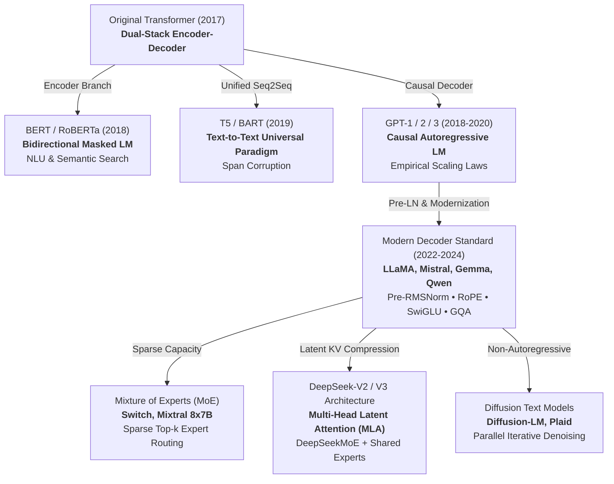
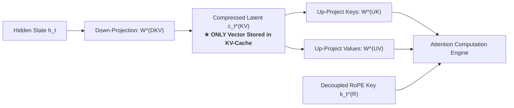

The architectural history of large language models is an empirical search for the Pareto frontier balancing three engineering tensions: **representation capacity**, **parallel training throughput**, and **inference generation latency**.

Rather than remaining a static template, the Transformer evolved through distinct epochs. Each architectural pivot was triggered by a concrete hardware bottleneck, computational barrier, or scaling law discovery—culminating in modern frontier models that synthesize sparse routing, latent memory compression, and non-autoregressive sampling.

---

## Architectural Lineage & Structural Paradigms

The structural evolution of language models across computational epochs:



---

## 1. Canonical Encoder-Decoder Architecture (Vaswani et al. 2017)

Prior to 2017, sequence-to-sequence translation relied on recurrent networks that processed words one step at a time. The original Transformer (Vaswani et al. 2017) broke this bottleneck by introducing a dual-stack **Encoder-Decoder** architecture built purely on self-attention and cross-attention.

```
Source Sequence (e.g. French)          Target Sequence (e.g. English)
           │                                       │
     ┌─────▼─────┐                           ┌─────▼─────┐
     │  Encoder  │                           │  Decoder  │
     │  (Bi-dir  │                           │  (Causal  │
     │ Attention)│                           │ Attention)│
     └─────┬─────┘                           └─────┬─────┘
           │                                       │
           └────────────► [Cross-Attention] ◄──────┘
                                   │
                           ┌───────▼───────┐
                           │   Next Word   │
                           │  Prediction   │
                           └───────────────┘
```

### Asymmetric Cross-Attention Conditioning
* The **Encoder** consumes the complete source sentence using unmasked bidirectional attention, computing contextual representations $H_{\text{enc}} \in \mathbb{R}^{S \times d}$.
* The **Decoder** generates the target sentence autoregressively. Each decoder layer contains two distinct attention operations:
  1. **Causal Masked Self-Attention**: Allows target tokens to attend only to earlier generated target tokens.
  2. **Cross-Attention**: The target token emits a **Query** ($Q$), but retrieves **Keys** ($K$) and **Values** ($V$) directly from the encoder representations $H_{\text{enc}}$:
     $$
     \text{CrossAttention}(Q_{\text{dec}}, K_{\text{enc}}, V_{\text{enc}}) = \text{softmax}\left(\frac{Q_{\text{dec}} K_{\text{enc}}^T}{\sqrt{d_k}}\right) V_{\text{enc}}
     $$

This cross-attention bridge allows the generating decoder to condition each new word on the global semantic context of the entire source sentence.

---

## 2. Structural Specialization: Masked, Causal, and Unified Sequence Models

Between 2018 and 2020, researchers discovered that the two halves of the original Transformer could be decoupled to optimize for fundamentally different objectives:

### Bidirectional Masked Encoders (BERT, RoBERTa)
By discarding the decoder and training solely on **Masked Language Modeling (MLM)** (randomly masking 15% of tokens and training the model to predict them from surrounding bidirectional context), BERT achieved state-of-the-art results in natural language understanding, classification, and semantic search.
* **The Structural Limit**: Because every layer attends bidirectionally to the entire sequence simultaneously, an encoder cannot generate open-ended text autoregressively without performing an entirely new forward pass for every single token from scratch.

### Autoregressive Causal Decoders (GPT Series)
By discarding the encoder and training purely on **causal autoregressive next-token prediction** ($p(x_t \mid x_{<t})$), the GPT series demonstrated that simple causal prediction at massive scale absorbs world knowledge, reasoning abilities, and task adaptation without requiring task-specific heads. Empirical scaling laws (Kaplan et al. 2020, Chinchilla 2022) proved that causal decoders maximize compute efficiency during self-supervised pre-training.

### Unified Sequence-to-Sequence Modeling (T5, BART)
The Text-to-Text Transfer Transformer (T5) unified all NLP tasks (translation, summarization, question answering, classification) under a single sequence-to-sequence format: *"input text $\to$ output text"*. While architecturally elegant, maintaining dual encoder-decoder parameter weights proved less parameter-efficient than monolithic decoders for conversational and code-generation workloads.

---

## 3. The Modern Dense Decoder Standard (LLaMA, Mistral, Gemma)

Modern foundation models (LLaMA 1/2/3, Mistral, Gemma, Qwen) converge on a refined autoregressive decoder block engineered for training stability at depth and inference throughput:

### Pre-RMSNorm Residual Stabilization vs. Post-LN Vanishing Gradients
The original Transformer placed normalization **after** the residual addition (Post-LN):
$$
x_{l+1} = \text{LayerNorm}(x_l + \text{SubLayer}(x_l))
$$
In deep networks (e.g. $>32$ layers), Post-LN causes gradients to explode or vanish near the output, requiring delicate learning rate warmups and low learning rates.

Modern architectures use **Pre-RMSNorm**, normalizing activations **before** feeding them to the sublayer:
$$
x_{l+1} = x_l + \text{SubLayer}(\text{RMSNorm}(x_l))
$$
Pre-normalization preserves an unobstructed residual stream (a "gradient highway") where the identity mapping allows gradients to backpropagate unimpeded from layer $L$ to layer $1$, enabling 100+ layer models to train stably.

### SwiGLU Gated Activation Multi-Layer Perceptrons
Traditional transformers used a two-layer MLP with ReLU or GELU activations:
$$
\text{FFN}(x) = \text{GELU}(x W_1 + b_1) W_2 + b_2
$$

Modern architectures use **SwiGLU** (Shazeer 2020), a Gated Linear Unit with Swish activation ($\text{Swish}(x) = x \cdot \sigma(\beta x)$):
$$
\text{SwiGLU}(x) = \left( \text{Swish}(x W_{\text{gate}}) \odot (x W_{\text{up}}) \right) W_{\text{down}}
$$
where $\odot$ denotes element-wise multiplication. By using a dynamic multiplicative gating branch, SwiGLU allows the network to suppress or amplify individual feature dimensions conditionally. To maintain parameter parity with standard FFNs (which expand hidden dimension by $4d$), SwiGLU typically expands to $\frac{8}{3}d$.

---

## 4. Sparse Mixture of Experts (MoE): Decoupling Capacity from FLOP Budgets

In a standard dense Transformer, every parameter is activated for every token. Scaling model capacity to hundreds of billions of parameters linearly multiplies the floating-point operations (FLOPs) and compute budget per token.

**Mixture of Experts (MoE)** decouples total parameter capacity from per-token compute:
* The monolithic Feed-Forward Network is replaced by $E$ distinct, parallel **Expert** networks $\{E_1, E_2, \dots, E_n\}$.
* A learned **Gating Router** calculates a probability distribution over the experts:
  $$
  H(x) = \text{Softmax}(\text{TopK}(x \cdot W_g, k))
  $$
* Only the top-$k$ experts (e.g. $k=2$ out of $E=8$ in Mixtral 8x7B) are activated for a given token:
  $$
  y = \sum_{i \in \text{TopK}} g(x)_i E_i(x)
  $$

```
Input Token x ────► [ Gating Router ] ───► Select Top-2 Experts
                          │
         ┌────────────────┴────────────────┐
         ▼                                 ▼
   [ Expert #2 ]                     [ Expert #7 ]
         │                                 │
         └───────────────► ⨁ ◄─────────────┘
                           │
                     Output Tensor y
```

### MoE Distributed Systems Challenges: All-to-All Routing & Load Balancing
1. **Router Collapse & Load Imbalance**: Without intervention, the router tends to send all tokens to a handful of slightly favored experts, starving others and degenerating into a smaller dense model. Models use auxiliary load-balancing losses to enforce uniform distribution.
2. **VRAM Footprint**: While compute per token corresponds to an active parameter count (e.g., 13B FLOPs), all 47B parameters must reside in GPU memory simultaneously, requiring multi-GPU expert parallelism.

---

## 5. Modern Efficiency Breakthroughs: Low-Rank KV Compression & Fine-Grained MoE

DeepSeek-V2 and V3 introduced two breakthroughs that redefine memory and parameter efficiency at scale:



### Multi-Head Latent Attention (MLA): Low-Rank Joint KV Compression
Standard Grouped-Query Attention (GQA) reduces KV-cache by having multiple query heads share key-value heads. DeepSeek took this to the theoretical limit by introducing **low-rank joint compression**:

1. **Down-Projection to Compressed Latent**:
   Instead of caching full high-dimensional Keys and Values for every token, MLA projects the hidden state $h_t$ down into a compact latent vector $c_t^{KV} \in \mathbb{R}^{d_c}$ (where $d_c \ll n_h d_h$):
   $$
   c_t^{KV} = W^{DKV} h_t
   $$
2. **The Cache Advantage**:
   **Only $c_t^{KV}$ is saved to the KV-cache during generation**. This slashes the memory footprint by over **85%** compared to standard MHA.
3. **On-the-Fly Up-Projection**:
   During attention computation, the compact vector $c_t^{KV}$ is decompressed into multi-head keys and values via up-projection matrices $W^{UK}$ and $W^{UV}$, with a decoupled RoPE vector handling positional rotations.

### DeepSeekMoE: Dedicated Shared Experts & Auxiliary-Loss-Free Routing
Traditional MoEs (like Mixtral) use a small number of coarse experts (e.g. 8 experts, routing top-2). DeepSeekMoE divides the capacity into much finer-grained units (e.g., 64 routed experts, activating top-8) and adds **dedicated shared experts**:

* **Shared Experts**: Fixed experts that are **always active** for every token, capturing common, baseline syntactic and linguistic structures.
* **Routed Experts**: Fine-grained specialists that capture niche domain knowledge.
* **Auxiliary-Loss-Free Balancing**: Dynamically adjusting router bias terms rather than adding disruptive penalty losses to the training objective, achieving perfect load balancing without degrading model perplexity.

---

## 6. Non-Autoregressive Paradigms: Continuous & Discrete Text Diffusion

While causal autoregression dominates production models, it suffers from intrinsic architectural constraints:
1. **Sequential Latency**: Generating an $N$-token response requires $N$ sequential forward passes through all layers.
2. **Exposure Bias & Lack of Lookahead**: The model commits to tokens strictly left-to-right. It cannot revise earlier tokens based on downstream reasoning or draft a global outline before filling in technical details.

### Parallel Iterative Denoising & Score-Based Text Generation
Text diffusion models (such as Diffusion-LM and Plaid) treat text generation as an iterative **denoising process** across continuous latent spaces or discrete token embeddings:

$$
x_T \sim \mathcal{N}(0, I) \quad \xrightarrow{\text{Denoise Step } T-1} \quad x_{T-1} \quad \cdots \quad \xrightarrow{\text{Denoise Step 0}} \quad x_0 \text{ (Target Text)}
$$

* Rather than generating tokens left-to-right, the model begins with completely masked or noisy sequence vectors across the entire target length simultaneously.
* Over a fixed schedule of refinement steps (e.g. 20–50 steps), a bidirectional Transformer denoises all positions in parallel.
* This allows bidirectional global planning, non-monotonic sentence structure revisions, and controllable attribute conditioning.
* As research into discrete flow matching and score-based generation accelerates, diffusion language models represent an active frontier for controllable and parallel non-autoregressive generation.

---

## Seminal Papers & References


  
  
  
  
  
  

