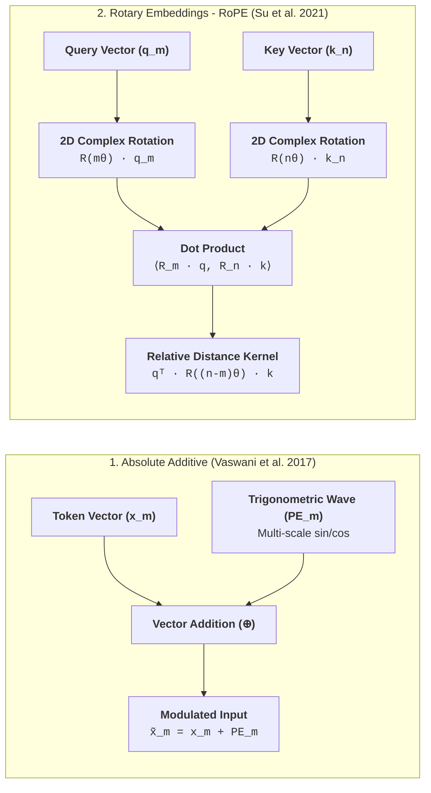

The core mathematical engine of the Transformer is self-attention. While self-attention allows every token to directly interact with every other token in a single parallel operation, it possesses a fundamental mathematical property: **permutation equivariance**.

Let $\mathbf{X} \in \mathbb{R}^{N \times d}$ be an input sequence of $N$ token embeddings, and let $\mathbf{P} \in \{0, 1\}^{N \times N}$ be an arbitrary permutation matrix that shuffles the rows of $\mathbf{X}$. Applying self-attention to the permuted sequence yields:

$$
\text{Attention}(\mathbf{P}\mathbf{X}) = \mathbf{P} \, \text{Attention}(\mathbf{X})
$$

Permuting the inputs simply permutes the outputs identically. The operation itself contains **zero structural awareness of sequence order**. To a pure transformer without positional coordinates, the sentences:

> *"The dog bit the mailman."*  
> *"The mailman bit the dog."*

produce identical sets of contextual representations. Because language, syntax, logic, and causality depend strictly on word order, models must explicitly break this permutation symmetry by injecting positional coordinates into the vector representations.

---

## Why Transformers Need Positional Information

To teach a neural network where words appear in time, two primary philosophies exist:



---

## Sinusoidal Positional Encoding

The original Transformer encoded sequence position by adding deterministic trigonometric waves of geometrically decreasing frequencies directly to token embeddings:

$$
PE_{(pos, 2i)} = \sin\left(\frac{pos}{10000^{2i/d}}\right)
$$
$$
PE_{(pos, 2i+1)} = \cos\left(\frac{pos}{10000^{2i/d}}\right)
$$

where $pos$ is the token position index ($0, 1, 2, \dots$), $i$ is the dimension pair index ($0 \le i < d/2$), and $d$ is the model embedding dimension.

### Geometric Intuition

Think of sinusoidal encoding like a multi-hand clock or a binary counter:
* **Dimension $i=0$ (The "Seconds Hand")**: Has a wavelength of $\lambda \approx 6.28$ tokens ($2\pi$). It oscillates rapidly, allowing the model to distinguish between immediately adjacent words (*"cat sat"* vs *"sat cat"*).
* **Intermediate Dimensions (The "Minutes Hand")**: Have wavelengths spanning hundreds of tokens, capturing phrase and clause boundaries.
* **Highest Dimensions (The "Hours Hand")**: Have wavelengths spanning tens of thousands of tokens ($\lambda = 20000\pi \approx 62{,}831$), tracking high-level thematic position across long documents.

Because every position produces a unique fingerprint across the frequency spectrum, the model can infer both absolute location and relative distance through trigonometric linear combinations ($\cos(\alpha - \beta) = \cos \alpha \cos \beta + \sin \alpha \sin \beta$).

---

## Rotary Position Embedding (RoPE)

While sinusoidal encodings add vectors ($\mathbf{x} + \mathbf{PE}$), modern frontier LLMs (LLaMA 3, Mistral, Gemma, Qwen) use **Rotary Position Embeddings (RoPE)**. 

Instead of adding static vectors to word embeddings, RoPE treats pairs of features inside the Query and Key vectors as 2D complex numbers and **rotates** them by an angle proportional to the token's position.

### 1. Rotating Query and Key Vectors

For a 2D feature pair $\mathbf{x} = [x_1, x_2]^T$ at token position $m$, RoPE applies the 2D rotation matrix $\mathbf{R}_{\theta, m}$:

$$
\mathbf{R}_{\theta, m} = \begin{bmatrix}
\cos(m\theta) & -\sin(m\theta) \\
\sin(m\theta) &  \cos(m\theta)
\end{bmatrix}
$$

In the complex plane $\mathbb{C}$, if we write the 2D vector as a complex number $z = x_1 + i x_2$, multiplying by $\mathbf{R}_{\theta, m}$ is mathematically equivalent to multiplying by a complex phase factor:

$$
\tilde{z} = z \cdot e^{i m \theta}
$$

### 2. Relative Position Invariance

Suppose token $m$ emits Query $\mathbf{q}$ and token $n$ emits Key $\mathbf{k}$. When the self-attention layer computes their dot product:

$$
\langle \mathbf{R}_{\theta, m} \mathbf{q}, \, \mathbf{R}_{\theta, n} \mathbf{k} \rangle = (\mathbf{R}_{\theta, m} \mathbf{q})^T (\mathbf{R}_{\theta, n} \mathbf{k}) = \mathbf{q}^T \mathbf{R}_{\theta, m}^T \mathbf{R}_{\theta, n} \mathbf{k}
$$

Because rotation matrices are orthogonal ($\mathbf{R}^T = \mathbf{R}^{-1}$) and rotations compose additively ($\mathbf{R}_a \mathbf{R}_b = \mathbf{R}_{a+b}$):

$$
\mathbf{R}_{\theta, m}^T \mathbf{R}_{\theta, n} = \mathbf{R}_{\theta, -m} \mathbf{R}_{\theta, n} = \mathbf{R}_{\theta, n-m}
$$

$$
\langle \mathbf{R}_{\theta, m} \mathbf{q}, \, \mathbf{R}_{\theta, n} \mathbf{k} \rangle = \mathbf{q}^T \mathbf{R}_{\theta, n-m} \mathbf{k}
$$

> **The Core Mathematical Invariance**:  
> The inner product depends **strictly on the relative displacement $(n - m)$**, completely independent of absolute token coordinates.  
> Whether two words appear at positions $(1, 3)$ or positions $(501, 503)$, their relative angle is $(3 - 1)\theta = 2\theta$, producing an identical attention score!

---

## Interactive RoPE Simulator

Use the interactive simulator below to rotate Query $\mathbf{q}$ and Key $\mathbf{k}$ on the complex unit circle. Notice that shifting both positions simultaneously preserves the relative angle and produces the exact same dot product:



---

## PyTorch Implementation

Here is how Rotary Position Embeddings are implemented in modern LLM architectures:

```python
import torch

def precompute_freqs_cis(dim: int, max_seq_len: int, theta: float = 10000.0) -> torch.Tensor:
    """Precomputes complex exponential rotation factors e^(i * m * theta)."""
    # 1. Frequency bands: theta_i = 1.0 / (theta ** (2i / dim))
    freqs = 1.0 / (theta ** (torch.arange(0, dim, 2)[: (dim // 2)].float() / dim))
    
    # 2. Position indices [0, 1, ..., max_seq_len - 1]
    positions = torch.arange(max_seq_len)
    
    # 3. Outer product: angles m * theta_i
    angles = torch.outer(positions, freqs)
    
    # 4. Complex polar coordinate tensor: e^(i * angle)
    return torch.polar(torch.ones_like(angles), angles)

def apply_rotary_emb(x: torch.Tensor, freqs_cis: torch.Tensor) -> torch.Tensor:
    """
    Applies 2D rotation to consecutive feature pairs of Queries or Keys.
    x shape: [batch_size, seq_len, num_heads, head_dim]
    """
    # View feature pairs as complex numbers: [B, T, H, head_dim // 2]
    x_complex = torch.view_as_complex(x.float().reshape(*x.shape[:-1], -1, 2))
    
    # Broadcast rotation frequencies
    freqs_cis = freqs_cis[: x.shape[1], None, :]
    
    # Rotate via complex multiplication: z_rotated = z * e^(i * m * theta)
    x_rotated = x_complex * freqs_cis
    
    # Flatten back to real coordinates: [B, T, H, head_dim]
    return torch.view_as_real(x_rotated).flatten(-2)
```

---

## Extending Context Windows: RoPE Scaling & YaRN

When an LLM trained with RoPE on an $8{,}192$-token context window is asked to evaluate $128{,}000$ tokens, the rotation angles $m\theta$ enter unobserved geometric territory, causing attention entropy to destabilize.

Modern techniques extend context windows without retraining from scratch:

1. **Linear Position Interpolation (PI)**: Scales down position indices $m \to m \cdot \frac{L_{\text{train}}}{L_{\text{target}}}$. This maps all positions back into the observed range, but compresses high-frequency dimensions too tightly, impairing local grammatical distinctions.
2. **Base Frequency $\theta$ Scaling (Llama 3)**: Increasing the base frequency from $\theta = 10{,}000$ to $\theta = 500{,}000$ (or $1{,}000{,}000$) slows the rotation rate across all dimensions, preserving fine-grained positional resolution across $128\text{k}+$ tokens.
3. **YaRN (Yet another RoPE extensioN)**: Applies non-uniform frequency scaling. It leaves high frequencies unscaled (preserving local syntax), linearly interpolates low frequencies (expanding long-range context), and applies an entropy temperature correction to prevent attention dilution.

---

## Comparing Positional Encodings

| Paradigm | Exemplar Models | Mathematical Mechanism | Extrapolation to Unseen Lengths |
| :--- | :--- | :--- | :--- |
| **Learned Absolute** | GPT-2, BERT | Learned embedding matrix $\mathbf{W}_{\text{pos}} \in \mathbb{R}^{L_{\max} \times d}$ | **Zero** — Hard error if sequence length exceeds $L_{\max}$ |
| **Sinusoidal Absolute** | Vaswani (2017) | Fixed harmonic sine/cosine waves added to token vectors | **Poor** — Attention weights degrade outside training length |
| **Relative Bias (ALiBi)** | MPT, BLOOM | Subtracts distance penalty directly from attention logits ($QK^T / \sqrt{d} - m \cdot \|i - j\|$) | **Excellent** — Trains on 2k, tests on 8k+ without fine-tuning |
| **Rotary (RoPE)** | LLaMA 3, Mistral, Gemma | Multiplies Q and K by block-diagonal 2D complex rotation matrices | **Very High** — Scales seamlessly to 128k–1M tokens with YaRN |

---

## Key Papers & References


  
  
  
  

