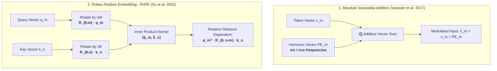
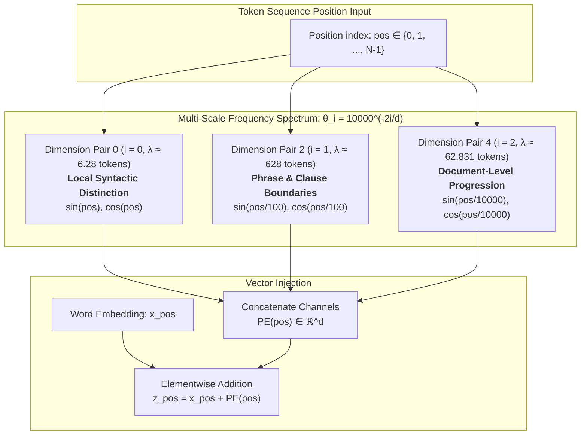
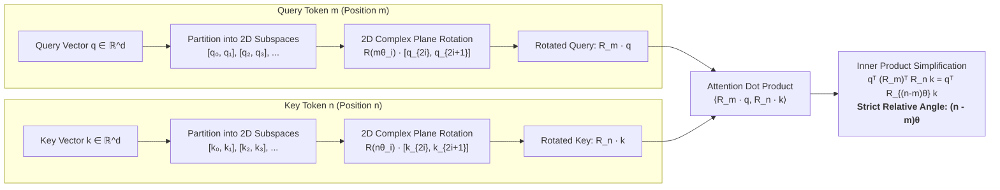

The core mathematical operation of the Transformer architecture is self-attention. While self-attention allows every token to interact directly with every other token in a single computational step, it possesses a fundamental mathematical property: **permutation equivariance**.

Let $\mathbf{X} \in \mathbb{R}^{N \times d}$ be an input sequence of $N$ token embeddings, and let $\mathbf{P} \in \{0, 1\}^{N \times N}$ be an arbitrary permutation matrix that reorders the rows of $\mathbf{X}$. Applying self-attention to the permuted sequence yields:

$$
\text{Attention}(\mathbf{P}\mathbf{X}) = \mathbf{P} \, \text{Attention}(\mathbf{X})
$$

Permuting the inputs simply permutes the outputs identically. The operation itself contains **zero structural awareness of sequence order**. To a pure transformer without positional encoding, the sentences:

> *"The dog bit the mailman."*  
> *"The mailman bit the dog."*

produce identical sets of contextual representations. Because syntax, grammar, causality, and logic depend strictly on sequential ordering, models must explicitly break this permutation symmetry by injecting positional coordinates into the vector representations.

---

## Coordinate Frame Formulation: Additive vs. Rotary

The two primary paradigms for breaking permutation symmetry operate either by direct vector addition or coordinate rotation:

---

## Mathematical Derivation & Vector Construction

### Absolute Harmonic Encodings (Vaswani et al.)
The original Transformer encodes sequence position by adding deterministic trigonometric waves of varying frequencies directly to the token embeddings:

$$
PE_{(pos, 2i)} = \sin\left(\frac{pos}{10000^{2i/d}}\right)
$$
$$
PE_{(pos, 2i+1)} = \cos\left(\frac{pos}{10000^{2i/d}}\right)
$$

where $pos$ is the token index ($0, 1, 2, \dots$), $i$ is the dimension index ($0 \le i < d/2$), and $d$ is the model dimension.

#### Numerical Evaluation at Fixed Hidden Dimension ($d = 4$)
Let $d=4$, yielding two frequency channels:
* For $i=0$: $\lambda_0 = 10000^{0/4} = 10000^0 = \mathbf{1}$
* For $i=1$: $\lambda_1 = 10000^{2/4} = 10000^{0.5} = \sqrt{10000} = \mathbf{100}$

**1. Position $pos = 0$:**
$$
PE_{(0, 0)} = \sin(0 / 1) = \sin(0) = \mathbf{0.0}
$$
$$
PE_{(0, 1)} = \cos(0 / 1) = \cos(0) = \mathbf{1.0}
$$
$$
PE_{(0, 2)} = \sin(0 / 100) = \sin(0) = \mathbf{0.0}
$$
$$
PE_{(0, 3)} = \cos(0 / 100) = \cos(0) = \mathbf{1.0}
$$
$$
\mathbf{PE}_0 = \begin{bmatrix} 0.0, & 1.0, & 0.0, & 1.0 \end{bmatrix}
$$

**2. Position $pos = 1$:**
$$
PE_{(1, 0)} = \sin(1 / 1) = \sin(1\text{ rad}) \approx \mathbf{0.8415}
$$
$$
PE_{(1, 1)} = \cos(1 / 1) = \cos(1\text{ rad}) \approx \mathbf{0.5403}
$$
$$
PE_{(1, 2)} = \sin(1 / 100) = \sin(0.01\text{ rad}) \approx \mathbf{0.0100}
$$
$$
PE_{(1, 3)} = \cos(1 / 100) = \cos(0.01\text{ rad}) \approx \mathbf{0.99995}
$$
$$
\mathbf{PE}_1 = \begin{bmatrix} 0.8415, & 0.5403, & 0.0100, & 0.99995 \end{bmatrix}
$$

#### Multi-Scale Frequency Decomposition & Geometric Progression
Notice that across dimension $i=0$, the coordinates oscillate rapidly with wavelength $2\pi \approx 6.28$ tokens. At dimension $i=1$, the wavelength expands to $200\pi \approx 628$ tokens. This forms a continuous analog to the binary bits of an integer counter: low dimensions provide high-resolution local distinction between adjacent tokens, while high dimensions track global position across long documents.

---

### Rotary Position Embedding (RoPE) & Complex Plane Coordinates
While sinusoidal encodings add vectors ($\mathbf{x} + \mathbf{PE}$), modern frontier models (LLaMA, Mistral, Gemma, Qwen) use **Rotary Position Embeddings (RoPE)**. RoPE does not add static position vectors; instead, it **rotates** the Query and Key vectors in 2D complex coordinate planes.

For a 2D vector $\mathbf{x} = [x_1, x_2]^T$ at position $m$, RoPE applies the orthogonal rotation matrix $\mathbf{R}_{\theta, m}$:

$$
\mathbf{R}_{\theta, m} = \begin{bmatrix}
\cos(m\theta) & -\sin(m\theta) \\
\sin(m\theta) &  \cos(m\theta)
\end{bmatrix}
$$

#### Orthogonal Invariance & Relative Displacement Proof
Suppose token $m$ emits Query $\mathbf{q}$ and token $n$ emits Key $\mathbf{k}$. When the model computes their attention dot product:

$$
\langle \mathbf{R}_{\theta, m} \mathbf{q}, \, \mathbf{R}_{\theta, n} \mathbf{k} \rangle = (\mathbf{R}_{\theta, m} \mathbf{q})^T (\mathbf{R}_{\theta, n} \mathbf{k}) = \mathbf{q}^T \mathbf{R}_{\theta, m}^T \mathbf{R}_{\theta, n} \mathbf{k}
$$

Because rotation matrices are orthogonal ($\mathbf{R}^T = \mathbf{R}^{-1}$) and rotations compose additively ($\mathbf{R}_a \mathbf{R}_b = \mathbf{R}_{a+b}$):

$$
\mathbf{R}_{\theta, m}^T \mathbf{R}_{\theta, n} = \mathbf{R}_{\theta, -m} \mathbf{R}_{\theta, n} = \mathbf{R}_{\theta, n-m}
$$

$$
\langle \mathbf{R}_{\theta, m} \mathbf{q}, \, \mathbf{R}_{\theta, n} \mathbf{k} \rangle = \mathbf{q}^T \mathbf{R}_{\theta, n-m} \mathbf{k}
$$

The inner product depends **strictly on the relative displacement `(n - m)`**, completely independent of absolute token indices. Whether two words appear at positions `(1, 3)` or positions `(501, 503)`, their attention score is mathematically identical.

---

## Systems Implementation & Context Extrapolation

### Comparative Taxonomy of Sequence Positional Inductive Biases

| Architecture Paradigm | Examples | Mechanism | Extrapolation to Unseen Lengths |
| :--- | :--- | :--- | :--- |
| **Absolute Learned** | GPT-2, BERT | Learned parameter matrix $\mathbf{W}_{\text{pos}} \in \mathbb{R}^{L_{\max} \times d}$ added to embeddings | **Zero** — cannot evaluate sequences longer than $L_{\max}$ |
| **Absolute Sinusoidal** | Original Transformer | Fixed sine/cosine formulas added to embeddings | Poor — attention weights degrade rapidly outside training distribution |
| **Relative Bias** | T5, ALiBi | Injects scalar distance penalty directly into attention logits ($QK^T / \sqrt{d} - m \cdot \|i - j\|$) | **Excellent** (ALiBi trains on 2k, tests on 8k+ without fine-tuning) |
| **Rotary (RoPE)** | LLaMA 1/2/3, Mistral, Gemma | Multiplies Q and K by block-diagonal 2D rotation matrices | **Very High** with base-frequency $\theta$ scaling and YaRN |

### Attention with Linear Biases (ALiBi): Direct Logit Distance Penalties
ALiBi demonstrated that explicit positional embeddings are unnecessary. Instead, it subtracts a static, non-learned linear penalty proportional to the token distance directly from the pre-softmax attention score:

$$
\text{Attention Matrix} = \text{softmax}\left(\frac{\mathbf{Q}\mathbf{K}^T}{\sqrt{d}} - m \cdot \begin{bmatrix}
0 & \infty & \infty & \cdots \\
1 & 0 & \infty & \cdots \\
2 & 1 & 0 & \cdots \\
\vdots & \vdots & \vdots & \ddots
\end{bmatrix}\right)
$$

where $m$ is a head-specific geometric slope (e.g. $2^{-8/H}$). By biasing the model to favor recent tokens, ALiBi allows models trained on 2,048 tokens to extrapolate seamlessly to 8,192 tokens without any degradation in perplexity.

### Context Window Expansion: Frequency Interpolation & YaRN
When an LLM trained with RoPE on an 8,192-token window is asked to process 128,000 tokens, the rotation angles $m\theta$ enter unobserved geometric territory, causing catastrophic attention collapse.

To extend context windows without re-training from scratch:

1. **Linear Position Interpolation (PI)**: Scales down the position index $m \to m \cdot \frac{L_{\text{train}}}{L_{\text{target}}}$. This compresses all positions back into the training range, but squeezes high frequencies too closely, damaging local grammar distinctions.
2. **Base Frequency $\theta$ Scaling (Llama 3)**: The default base frequency is $\theta_0 = 10{,}000$. Increasing $\theta_0 \to 500{,}000$ (as in Llama 3) dramatically slows the rotation rate of all dimensions, enabling the model to distinguish tokens across 128k contexts without compressing local positional resolution.
3. **YaRN (Yet another RoPE extensioN)**: Applies non-uniform frequency interpolation. It treats high-frequency dimensions with zero interpolation (preserving exact local syntax), interpolates low-frequency dimensions linearly (expanding global context), and applies an entropy temperature correction to prevent attention entropy from diluting over 100k+ tokens.

---

## Seminal Papers & References


  
  
  
  

