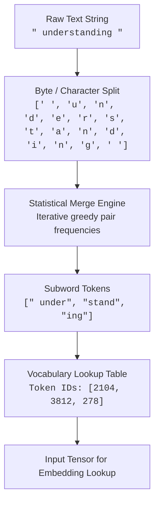

Human natural language exists as discrete, variable-length symbolic sequences governed by morphology, syntax, and cultural convention. Deep neural networks, conversely, are differentiable mathematical engines that operate exclusively on continuous numerical vectors within dense coordinate spaces. The bridge between these two irreconcilable representations is **tokenization**.

The design of a tokenizer is governed by a fundamental tension in sequence modeling:

1. **Character-level representation** guarantees zero out-of-vocabulary (OOV) errors because any text decomposes into Unicode code points. However, it inflates sequence length by an order of magnitude. Because self-attention scales quadratically ($\mathcal{O}(N^2)$) in compute and memory with respect to sequence length $N$, processing text character-by-character imposes a crushing computational tax on every attention layer.
2. **Word-level representation** keeps sequence lengths short and preserves clear semantic units. However, human vocabulary is practically infinite: proper nouns, technical jargon, typos, and morphologically rich languages generate an open-ended vocabulary. A fixed word vocabulary requires enormous embedding matrices ($V \times d$) and inevitably fails when encountering unseen words at inference time.

Subword tokenization resolves this dilemma. By treating words not as atomic entities but as compositional sequences of high-frequency subword fragments, subword algorithms achieve the Pareto-optimal trade-off: common words remain single tokens, rare words break down into understandable morphemes, and sequence length remains computationally manageable.

---

## The Tokenization Pipeline

The pipeline transforms raw UTF-8 text streams into discrete integer index tensors through statistical subword chunking:



---

## Step-by-Step Toy Walkthrough: Byte-Pair Encoding (BPE)

To see the mechanics in action, consider building a BPE tokenizer from scratch on a miniature training corpus consisting of four words with their respective frequencies:

$$
\mathcal{D} = \{ \text{"low": 5}, \quad \text{"lower": 2}, \quad \text{"newest": 6}, \quad \text{"widest": 3} \}
$$

### Step 1: Base Vocabulary Initialization
We append a special end-of-word suffix `</w>` to each word to preserve word boundary information across merges. We split each word into individual character symbols:

* `l o w </w>` (frequency: 5)
* `l o w e r </w>` (frequency: 2)
* `n e w e s t </w>` (frequency: 6)
* `w i d e s t </w>` (frequency: 3)

The base vocabulary $V_0$ contains all unique symbols:
$$
V_0 = \{ \text{'d'}, \text{'e'}, \text{'i'}, \text{'l'}, \text{'n'}, \text{'o'}, \text{'r'}, \text{'s'}, \text{'t'}, \text{'w'}, \text{'</w>'} \} \quad (|V_0| = 11)
$$

### Step 2: Iteration 1 — Pair Counting & Selection
We scan the corpus and count all adjacent pairs of symbols:

| Adjacent Symbol Pair | Occurrences Across Corpus | Total Frequency |
| :--- | :--- | :--- |
| `('e', 's')` | $(6 \times 1) + (3 \times 1)$ | **9** |
| `('s', 't')` | $(6 \times 1) + (3 \times 1)$ | **9** |
| `('l', 'o')` | $(5 \times 1) + (2 \times 1)$ | 7 |
| `('o', 'w')` | $(5 \times 1) + (2 \times 1)$ | 7 |
| `('w', 'e')` | $(6 \times 1)$ | 6 |
| `('n', 'e')` | $(6 \times 1)$ | 6 |
| `('w', '</w>')` | $(5 \times 1)$ | 5 |

Both `('e', 's')` and `('s', 't')` share the top frequency of 9. Breaking ties deterministically, we select `('e', 's')` to merge.

* **Merge Rule 1**: `('e', 's')` $\to$ `'es'`
* **Corpus state**:
  * `l o w </w>` (5)
  * `l o w e r </w>` (2)
  * `n e w es t </w>` (6)
  * `w i d es t </w>` (3)

### Step 3: Iteration 2 — Merging the Next Most Frequent Pair
Re-evaluating adjacent pair frequencies in the updated corpus:
* `('es', 't')`: appears $6 + 3 = \mathbf{9}$ times.
* `('l', 'o')`: appears $5 + 2 = 7$ times.

The top pair is `('es', 't')`.
* **Merge Rule 2**: `('es', 't')` $\to$ `'est'`
* **Corpus state**:
  * `l o w </w>` (5)
  * `l o w e r </w>` (2)
  * `n e w est </w>` (6)
  * `w i d est </w>` (3)

### Step 4: Iteration 3 — Merging Root Stems
Next, `('l', 'o')` and `('o', 'w')` both occur 7 times:
* **Merge Rule 3**: `('l', 'o')` $\to$ `'lo'`
* **Merge Rule 4**: `('lo', 'w')` $\to$ `'low'`
* **Corpus state**:
  * `low </w>` (5)
  * `low e r </w>` (2)
  * `n e w est </w>` (6)
  * `w i d est </w>` (3)

### Step 5: Tokenizing an Unseen Word
Suppose the model receives the previously unseen word **`"lowest"`**.
1. Split into base characters: `['l', 'o', 'w', 'e', 's', 't', '</w>']`
2. Check merge rule book in chronological training order:
   * Rule 1 applies: `['l', 'o', 'w', 'es', 't', '</w>']`
   * Rule 2 applies: `['l', 'o', 'w', 'est', '</w>']`
   * Rule 3 applies: `['lo', 'w', 'est', '</w>']`
   * Rule 4 applies: `['low', 'est', '</w>']`
3. Final token output: **`["low", "est</w>"]`**

Despite `"lowest"` never appearing in the training corpus, the tokenizer cleanly decomposes it into two semantically meaningful root morphemes without throwing an unknown token error.

---

## A Bit Deeper: Systems & Mechanics

### Byte-Level Fallback & The Zero-OOV Guarantee
Early BPE models (like Sennrich et al. 2015) operated over Unicode characters. If an input contained an unencountered emoji, rare mathematical symbol, or character from an unsupported script, the tokenizer was forced to emit the destructive unknown token `[UNK]`.

Modern tokenizers (GPT-2, Tiktoken for GPT-4, Llama 3) eliminate `[UNK]` completely using **Byte-Level BPE**:
* The base vocabulary is initialized with all **256 individual raw bytes** ($0\text{x}00$ through $0\text{xFF}$) of the UTF-8 specification.
* Any valid Unicode character consists of 1 to 4 UTF-8 bytes. Even if a character was never observed during tokenizer pre-training, it can always decompose into its constituent raw bytes.
* Merges then iteratively combine high-frequency byte sequences into full UTF-8 characters and multi-character subwords.

```
Raw Input: "✨" (Sparkles Emoji)
UTF-8 Hex:  0xE2 0x9C 0xA8
Fallback:   Byte(226), Byte(156), Byte(168) -> Always representable!
```

### Algorithmic Comparison: BPE vs. WordPiece vs. SentencePiece

| Dimension | Byte-Pair Encoding (BPE) | WordPiece | SentencePiece / Unigram |
| :--- | :--- | :--- | :--- |
| **Pioneered By** | Sennrich et al. (2015); GPT series | Schuster & Nakajima (2012); BERT | Kudo (2018); T5, LLaMA, Mistral |
| **Optimization Objective** | Pure co-occurrence frequency ($\max \text{count}(p_1, p_2)$) | Maximum likelihood of unigram language model scoring | Prunes a large seed vocabulary down via unigram loss degradation |
| **Boundary Handling** | Often regex-based pre-tokenization (`gpt-4o`, `cl100k_base`) | Explicit prefix marking (e.g. `##ing`) | Treats whitespace as regular character (`_` or ` `) |
| **Deterministic?** | Yes, greedy top-down priority merge | Yes, greedy longest-match-first | Probabilistic (enables subword regularization during training) |

### Pathologies and Engineering Pitfalls

#### 1. Whitespace Sensitivity
Because whitespace characters are explicitly incorporated into tokens (represented as `Ġ` in GPT tokenizers or ` ` in SentencePiece), leading spaces fundamentally alter token identity:
* `" Apple"` $\to$ Token ID `1923`
* `"Apple"` $\to$ Token ID `9756`

Prompts with inconsistent spacing create representational drift in the early embedding layers because the model treats `" Apple"` and `"Apple"` as distinct coordinate vectors.

#### 2. Arithmetic & Digit Fragmentation
Standard BPE trains on raw text where numbers appear unpredictably. Without regex intervention, numbers are tokenized into inconsistent chunk sizes:
* `1234` might tokenize as `["12", "34"]`
* `12345` might tokenize as `["123", "45"]`
* `123456` might tokenize as `["1", "234", "56"]`

This erratic splitting forces the transformer attention layers to simultaneously infer decimal place value alignment and numerical operations. Frontier models (e.g., Llama 3 and GPT-4) enforce strict regex rules before BPE to split every individual digit into its own token (`split_digits: true`), dramatically stabilizing mathematical reasoning.

#### 3. Multilingual Fertility Disparity
Tokenizer vocabularies trained predominantly on English corpora allocate the vast majority of their subword entries to English words and morphemes.
* In English, **fertility** (the ratio of tokens generated per character) is roughly **0.25 to 0.30** (~4 characters per token).
* In non-Latin scripts (Hindi, Thai, Telugu, Arabic, Japanese), words frequently split into single bytes or tiny character fragments, pushing fertility to **0.80 to 1.20** tokens per character.

This discrepancy means non-English prompts consume 3x to 4x more tokens for the exact same semantic content, directly quadrupling inference latency and API cost while shortening the effective context window.

---

## Seminal Papers & References


  
  
  

