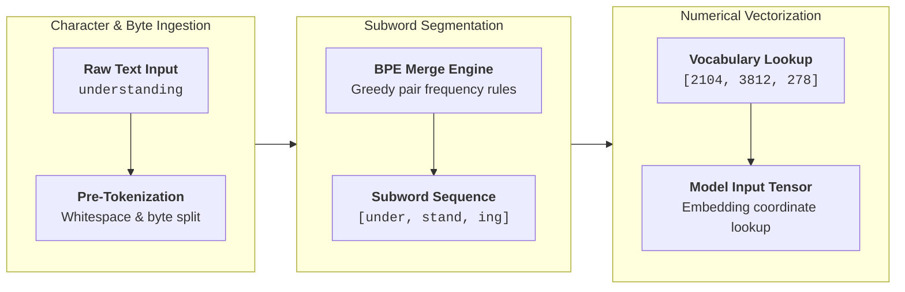

Human language exists as discrete, variable-length text strings governed by syntax, grammar, and morphology. Deep neural networks, conversely, are differentiable mathematical functions that operate strictly on continuous numerical vectors. The bridge between these two representations is **tokenization**.

The design of every tokenizer is governed by a fundamental tradeoff in sequence modeling:

1. **Character-Level Representation**: Guarantees zero out-of-vocabulary (OOV) errors because every text decomposes into individual Unicode characters. However, it inflates sequence length by an order of magnitude. Because self-attention compute and memory scale quadratically ($\mathcal{O}(N^2)$) with sequence length $N$, processing text character-by-character imposes a massive computational tax on every attention layer.
2. **Word-Level Representation**: Keeps sequence lengths short and preserves obvious semantic units. However, human vocabulary is practically open-ended: proper names, technical jargon, slang, and typos are infinite. A fixed word vocabulary requires enormous embedding matrices ($V \times d$) and inevitably fails when encountering unseen words at inference time.

**Subword tokenization** resolves this dilemma. By treating words as compositional sequences of high-frequency subword chunks, common words remain single tokens, rare words break down into familiar morphemes, and sequence length remains computationally efficient.

---

## How Tokenization Works

Modern tokenizers transform raw text into integer tensors through three distinct phases:

---

## The BPE Algorithm Walkthrough

To see how Byte-Pair Encoding (BPE) constructs its vocabulary, consider building a tokenizer from scratch on a miniature training corpus consisting of four words and their frequencies:

$$
\mathcal{D} = \{ \text{low}: 5, \quad \text{lower}: 2, \quad \text{newest}: 6, \quad \text{widest}: 3 \}
$$

### 1. Initial Character Vocabulary
We append a special end-of-word suffix `</w>` to each word to preserve word boundary information across merges. Each word starts split into individual character symbols:

* `l o w </w>` (frequency: 5)
* `l o w e r </w>` (frequency: 2)
* `n e w e s t </w>` (frequency: 6)
* `w i d e s t </w>` (frequency: 3)

The base vocabulary $V_0$ contains all 11 unique symbols:
$$
V_0 = \{ \text{d}, \text{e}, \text{i}, \text{l}, \text{n}, \text{o}, \text{r}, \text{s}, \text{t}, \text{w}, \text{</w>} \} \quad (|V_0| = 11)
$$

### 2. Counting Symbol Pairs
We scan the corpus and count all adjacent pairs of symbols:

| Adjacent Symbol Pair | Occurrences Across Corpus | Total Frequency |
| :--- | :--- | :--- |
| `e + s` | $(6 \times 1) + (3 \times 1)$ | **9** |
| `s + t` | $(6 \times 1) + (3 \times 1)$ | **9** |
| `l + o` | $(5 \times 1) + (2 \times 1)$ | 7 |
| `o + w` | $(5 \times 1) + (2 \times 1)$ | 7 |
| `w + e` | $(6 \times 1)$ | 6 |
| `n + e` | $(6 \times 1)$ | 6 |
| `w + </w>` | $(5 \times 1)$ | 5 |

Both `e + s` and `s + t` share the top frequency of 9. Breaking ties deterministically, we merge `e + s` first:

* **Merge Rule 1**: `e + s` $\to$ `es`
* **Updated Corpus**:
  * `l o w </w>` (5)
  * `l o w e r </w>` (2)
  * `n e w es t </w>` (6)
  * `w i d es t </w>` (3)

### 3. Merging Most Frequent Pairs
Re-evaluating adjacent pair frequencies in the updated corpus:
* `es + t` appears $6 + 3 = \mathbf{9}$ times.
* `est + </w>` then appears $6 + 3 = \mathbf{9}$ times.
* `l + o` and `lo + w` each appear $5 + 2 = \mathbf{7}$ times.

Applying these greedy merges in sequence produces five learned rules:
1. **Rule 1**: `e + s` $\to$ `es` (freq 9)
2. **Rule 2**: `es + t` $\to$ `est` (freq 9)
3. **Rule 3**: `est + </w>` $\to$ `est</w>` (freq 9)
4. **Rule 4**: `l + o` $\to$ `lo` (freq 7)
5. **Rule 5**: `lo + w` $\to$ `low` (freq 7)

### 4. Tokenizing Unseen Words
When the model encounters the previously unseen word **lowest**, it splits the word into base characters (`l o w e s t </w>`) and applies the learned merge rules in order, decomposing **lowest** into two root morphemes (`low` and `est</w>`) without throwing an unknown token error:



---

## Practical Edge Cases & Realities

### Byte-Level BPE & Zero Out-of-Vocabulary Tokens
Early BPE models operated on Unicode characters. If an input contained an unencountered emoji, rare mathematical symbol, or character from an unsupported script, the tokenizer emitted the destructive unknown token `[UNK]`.

Modern frontier tokenizers (Tiktoken for GPT-4, LLaMA 3, Gemma) eliminate `[UNK]` completely using **Byte-Level BPE**:
* The base vocabulary is initialized with all **256 raw bytes** ($0\text{x}00$ through $0\text{xFF}$) of the UTF-8 specification.
* Because every Unicode symbol decomposes into 1 to 4 UTF-8 bytes (for example, the emoji ✨ maps to UTF-8 bytes `0xE2`, `0x9C`, `0xA8`), any input text is representable without fallback errors.

### Numbers & Digit Splitting
Standard BPE trained on raw text merges numbers inconsistently:
* `1234` might tokenize as `12` + `34`
* `12345` might tokenize as `123` + `45`
* `123456` might tokenize as `1` + `234` + `56`

This unpredictable chunking forces attention layers to waste capacity inferring decimal alignment before performing arithmetic. Modern models enforce regex pre-tokenization rules that split every individual digit into its own token, stabilizing mathematical reasoning.

### Multilingual Fertility & Compute Cost
Tokenizer vocabularies trained predominantly on English corpora dedicate most entries to English morphemes.
* In English, **fertility** (tokens per character) is roughly **0.25 to 0.30** (~4 characters per token).
* In non-Latin scripts (Hindi, Arabic, Japanese, Telugu), text frequently splits into individual bytes, causing fertility to surge to **0.80 to 1.20** tokens per character.

This means non-English prompts consume $3\times$ to $4\times$ more tokens for the exact same semantic content, driving up API costs, inference latency, and memory consumption.

---

## Comparing Modern Tokenizers

| Algorithm | Used By | Optimization Objective | Boundary Handling |
| :--- | :--- | :--- | :--- |
| **Byte-Pair Encoding (BPE)** | GPT-4, LLaMA 3 | Co-occurrence frequency ($\max \text{count}(p_1, p_2)$) | Regex pre-tokenization with byte fallback |
| **WordPiece** | BERT | Likelihood of unigram language model | Explicit prefix marking (e.g. `##ing`) |
| **SentencePiece / Unigram** | T5, Mistral | Prunes seed vocabulary via unigram loss | Treats whitespace as a standard symbol (`▁`) |

---

## Key Papers & References


  
  
  

